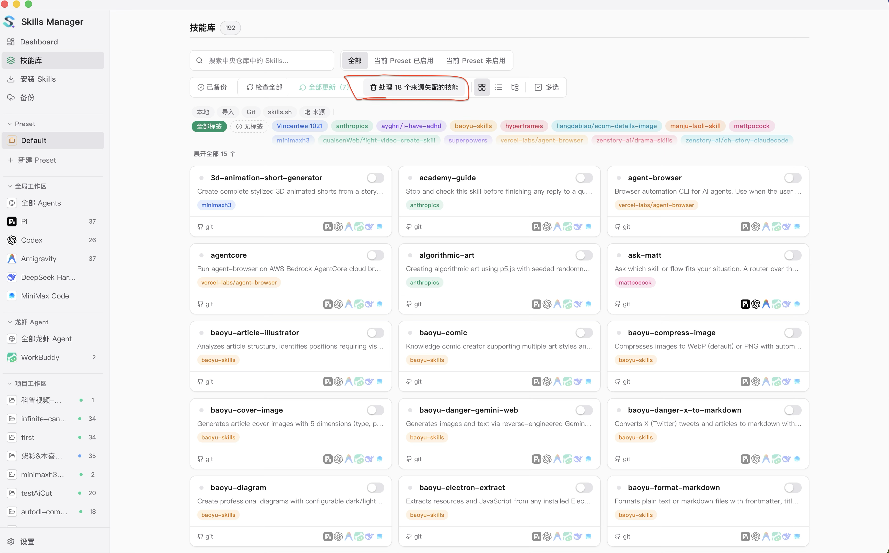
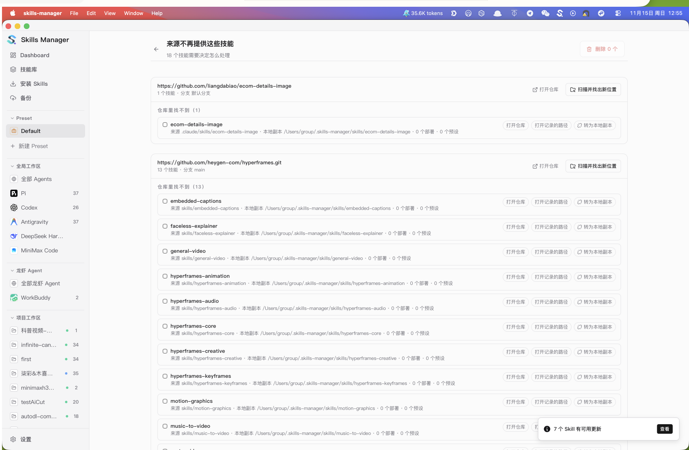
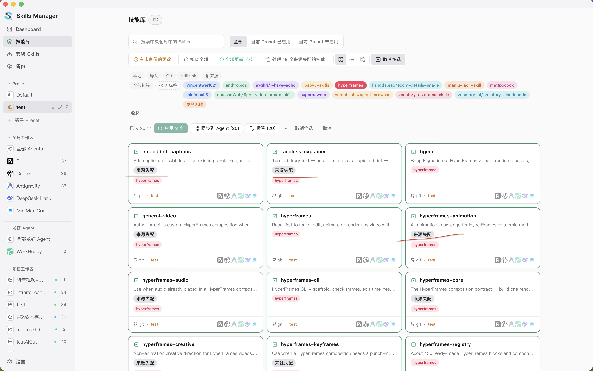

# Skills Manager — preview: a Skill its Source no longer holds

Screenshots of the app build from the `feat/source-gone-state` branch
(PR: xingkongliang/skills-manager — *a Skill its Source no longer holds*).
Nothing here is source code; it exists so the UI can be reviewed without
building the branch.

本仓库只存放这三张界面截图，方便维护者预览 `feat/source-gone-state` 分支的界面。
不含源码。

---

## What the branch does / 这个分支做了什么

A Git-installed Skill whose Source moved it, renamed it, rebuilt its history or
disappeared used to sit on "update available" forever, failed on every update
attempt, and burned a clone per auto-check round. It now has a terminal state,
and a page that explains it and offers a repair.

从 Git 安装的技能，上游搬家、改名、重写历史或整个仓库消失之后，原本会永远显示
「有更新」、每次更新都失败、每轮自动检查都白拉一次仓库。现在它有一个终止状态，
以及一个解释原因、提供修复动作的页面。

| | |
|---|---|
| Status / 状态名 | `source_gone` (in `skills check --json`) |
| Shown as / 界面文案 | 「来源失配」 / "Source mismatch" |
| Background rounds / 后台轮次 | skipped: no fetch, no attempt, not counted as failed |
| Local copy / 本地副本 | kept, still deployed / 保留，继续部署 |

---

## 1. Entry / 入口



The toolbar shows **处理 18 个来源失配的技能** only when there is something to
repair. Those 18 are the real case from the linked issue: upstream restructured
`heygen-com/hyperframes` and `liangdabiao/ecom-details-image`, and the app had
been retrying them for weeks.

工具栏只在确实有东西要处理时出现入口。这 18 个就是 issue 里的真实数据：上游整仓
重构，应用已经重试了数周。

---

## 2. Repair page / 修复页



A full page, grouped by *what can be done*, not by what went wrong:

- **可以原地更新** — the recorded path still holds the Skill, only the content changed.
- **在仓库里换了位置** — found elsewhere in the same checkout; one click re-points it,
  keeping id, presets, deployments, tags.
- **仓库里找不到** — nowhere in the checkout; detach the Source (keep the copy) or delete.
- **来源不可达** — 404 / private / empty repository.

Each row shows the recorded subpath, the library copy on disk, its deployment and
preset counts, and two links: **打开仓库** and **打开记录的路径**. The second one
404s when the path is really gone — that is the clearest evidence there is.

Scanning is per Source and on demand: one clone answers the whole group, and
nothing is cloned when the page opens.

整页按「还能做什么」分组，而不是按「哪里出错了」。每行给出记录的子路径、本地副本
路径、部署数与预设数，以及「打开仓库」「打开记录的路径」两个外链。扫描按来源、
按需触发：一个来源一次 clone，打开页面不发起任何克隆。

---

## 3. Badge / 徽标



The list shows 「来源失配」 in neutral grey — not red, not "update available".
It is not counted in the update badge, not picked by 「全部更新」, and the Skill
keeps deploying normally.

列表里是中性灰的「来源失配」，不是红色、不是「可更新」；不计入更新数量、
不被「全部更新」选中，技能照常部署。

---

## How this was verified / 验证方式

```
cargo test            710 passed, 7 ignored
cargo clippy          clean
npm run lint          eslint + UI spec + i18n checks pass
npm test              133 passed
npm run build         ok
```

Built on `f48bfa5`-era `main` (version 1.45.0), macOS arm64.

## Known limits / 已知限制

- A skills.sh Skill can only be judged at update time: the id lookup reads
  `SKILL.md` frontmatter, which the check's blobless fetch does not have.
- Cross-repository moves are not detected — the scan only looks inside one
  Source's checkout.
- Non-GitHub Sources get no "open the recorded path" link: no trustworthy tree
  URL can be built.
- The 7 Skills held back by the removals guard (#256) are out of scope here and
  keep their own behaviour; the issue thread records that as a separate proposal.
